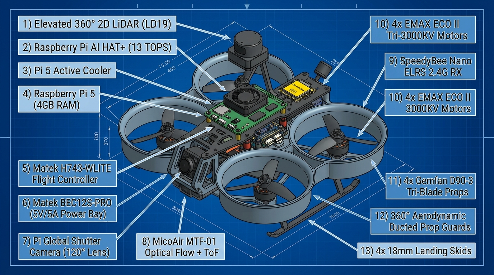

# Nidar-Navaneeth_works

**NIDAR 2026-27 | Track 1: Drone Innovation | PS2: NIDAR AirMouse**  
*Autonomous GPS-Denied Indoor Search, Mapping & Survivor Localisation Drone*

Developed by: **Navaneeth** (`Navaneeth2926`)

---

## 📌 Executive Summary

This repository contains the complete engineering design, rulebook compliance verification, parametric CAD models (Autodesk Fusion 360 & OpenSCAD), propulsion calculations, and hardware sourcing research for the **NIDAR AirMouse** challenge.

The mission requires an autonomous unmanned aerial system to navigate an unknown, GPS-denied, covered indoor maze (15m × 15m with 1m-wide corridors and 8ft vertical clearance), detect up to 6 survivors using onboard edge AI, generate and transmit a real-time 2D grid map to Ground Control Station via an offline local LAN, and safely exit through the designated access point within 30 minutes.

---

## 📋 Competition Rulebook Verdict: Commercial Airframe Legality

### Official Ruling
> **Commercial complete drone airframes and ready-to-fly (RTF) kits are STRICTLY DISALLOWED.**  
> Teams are required to independently design, integrate, and fabricate their airframe solutions.

### Exact Rulebook Citations
* **NIDAR Rulebook Ver 2.1 — Rule 8.2 (Page 16):**
  > *"8.2. The use of commercially available, market-ready or ready-to-fly complete drone airframes shall not be permitted. Teams may use commercially available components, open-source software and custom-developed hardware or software, unless otherwise specified in the relevant Problem Statement Annexure."*
* **NIDAR Rulebook Ver 2.1 — Rule 8.1 (Page 16):**
  > *"8.1. Teams shall independently design, develop, integrate and demonstrate their complete solutions."*
* **PS2 AirMouse Brief — Section 2 (Page 35) & Mission Brief (Page 2):**
  > *"● Use of commercially available market-ready or ready-to-fly complete drone airframes shall not be permitted."*  
  > *"● The combined all-up weight of the deployed drone, including batteries, onboard systems, sensors, communication equipment, payload mechanisms, and any other component, must not exceed 10 kg."*  
  > *"● The drone must be equipped with propeller covers or guards that fully protect the propeller operating area."*
* **Launch Area Constraint — Section 9 (Page 37):**
  > *"● The drone must be launched from within a fixed 2 feet x 2 feet launch area."*  
  > *"● No part of the drone shall cross or remain outside the designated launch area before mission start."*

---

## 🛠️ Complete System Specifications & Bill of Materials

### 📸 Labeled Drone Component Placement Architecture

*Detailed vertical stacking elevation and spatial coordinates are documented in [`docs/COMPONENT_PLACEMENT_AND_ARCHITECTURE.md`](./docs/COMPONENT_PLACEMENT_AND_ARCHITECTURE.md).*

| Subsystem | Component | Role & Functionality |
| :--- | :--- | :--- |
| **Airframe** | Custom 3.5" Unibody Ducted Cinewhoop | Aerospace Aluminum 7075-T6 / PETG-CF with 360° ducted prop guards. Outer width: **22.1 cm** ($\le 26.0\text{ cm}$ constraint). |
| **Flight Controller** | **Matek H743-WLITE** | High-performance STM32H743 autopilot running ArduPilot/PX4; dual IMU, baro, CAN bus, 7x UARTs. |
| **Power Distribution** | **Matek BEC12S-PRO** (9-55V) | Dedicated switching regulator providing clean 5.2V @ 5A for Raspberry Pi 5 & sensors, and 12V @ 2A for peripherals. |
| **Companion Computer** | **Raspberry Pi 5 (4GB RAM)** | Runs ROS 2, LiDAR SLAM (Cartographer / Hector SLAM), navigation, and survivor geolocation. |
| **Edge AI Accelerator** | **Raspberry Pi AI HAT+ (13 TOPS)** | Hailo-8L neural processor running real-time YOLOv8/v10 survivor detection inference at >30 FPS. |
| **Thermal Management** | **Raspberry Pi 5 Active Cooler** | Aluminum heatsink with PWM blower fan preventing thermal throttling under heavy neural inference. |
| **Vision Sensor** | **Raspberry Pi Global Shutter Camera** | High-speed global shutter sensor eliminating rolling shutter blur in high-vibration drone flight. |
| **2D Laser Sensor** | **360° Planar LiDAR (LD19 / RPLIDAR C1)** | Top-deck mounted 12m-range 2D LiDAR providing 360° obstacle avoidance and real-time indoor 2D occupancy grid mapping. |
| **Optical Flow & ToF** | **MicoAir MTF-01** (or Matek 3901-L0X) | Bottom-mounted optical flow camera + ToF distance sensor for sub-centimeter GPS-denied position and altitude hold. |
| **Radio Control Link** | **SpeedyBee Nano 2.4G ELRS Receiver** | Long-range, low-latency 2.4GHz ExpressLRS telemetry and safety emergency-stop link. |
| **Offline Network** | **Dedicated Wi-Fi 6 Dual-Band Router** | Offline 5GHz IEEE 802.11ax local LAN streaming live camera feed and 2D grid map to Ground Control Station. |
| **Propulsion Motors** | **2004 Brushless Motors (3000KV)** | EMAX ECO II 2004 (or T-Motor F2004) delivering ~520g thrust/motor on 4S. |
| **Propellers** | **Gemfan D90-3 / 3520-3 Tri-Blade** | 3.5" (90mm) 3-blade high-solidity ducted propellers. |
| **Power Filtering** | **Rubycon ZLH 35V 1000µF Low-ESR** | High ripple current filtering capacitor absorbing ESC switching spikes to protect digital electronics. |

---

## ⚡ Propulsion Physics & Motor Research

### 1. Why Smaller Drones (3.5") Require Higher Motor RPM
The aerodynamic thrust produced by a propeller is given by:
$$T \propto \rho \cdot D^4 \cdot n^2$$
Downsizing from a 5" prop to a 3.5" prop reduces the diameter factor $(D^4)$ by **over 75%** ($\frac{3.5^4}{5.0^4} \approx 0.24$). To generate the required ~2,000g total thrust to carry the ~680g AUW drone at a responsive **3:1 Thrust-to-Weight ratio**, the rotational speed $n$ must increase. A **3000KV motor on 4S LiPo (16.8V)** delivers the required loaded speed of ~35,000 RPM.

### 2. Propeller Blade Analysis: Tri-Blade (3-Blade) vs Twin-Blade (2-Blade)
* **Verdict: Tri-Blade (3-Blade) is significantly superior for indoor ducted cinewhoops.**
* **Key Advantages:**
  * **+25% Higher Static Thrust:** Compaction inside the fixed 3.5" duct diameter requires higher disc solidity.
  * **Duct Aerodynamic Shroud Coupling:** 3-blade props maintain steady boundary layer pressure along the duct wall, maximizing shroud lift.
  * **Lower IMU Vibration:** 3-blade distributes torque load across 120° intervals, reducing gyro ripple.
* **Recommended Propellers:** **Gemfan D90-3** (90mm, 3.0" pitch, 3-blade) or **Gemfan 3520-3** (3.5", 2.0" pitch, 3-blade).

### 3. Motor Sourcing Comparison (Budget: ₹5,000 - ₹7,000 max for 4 motors; Delivery < 2 weeks in India)

| Rank & Model | KV | Weight | Thrust (4S) | Price / Unit | Total (4 Motors) | Availability & Delivery |
| :---: | :---: | :---: | :---: | :---: | :---: | :--- |
| **#1 EMAX ECO II 2004** *(Top Pick)* | **3000KV** | 16.4g | 520g | **₹1,739** | **₹6,956** | **Robu.in** (In Stock, 2–4 days express delivery) |
| **#2 T-Motor F2004** | **3000KV** | 16.4g | 510g | **₹1,699** | **₹6,796** | **Robu.in / QuadKopter.in** (3–5 days) |
| **#3 HGLRC Aeolus 2004** | **3000KV** | 16.6g | 495g | **₹1,499** | **₹5,996** | **Robu.in / Drkarts** (3–5 days) |
| **#4 FLYCCI FK2004 V2** | **3150KV** | 16.2g | 535g | **₹1,350** | **₹5,400** | **Electropi / QuadKopter.in** (3–5 days) |

---

## 💻 CAD Models & Manufacturing Guide

### Files Included
* [`cad/generate_nidar_airmouse_frame.py`](./cad/generate_nidar_airmouse_frame.py): **Autodesk Fusion 360 Python API script** to procedurally model the parametric unibody frame.
* [`cad/nidar_airmouse_frame.scad`](./cad/nidar_airmouse_frame.scad): **OpenSCAD parametric design** ready for instant STL/3MF rendering.
* [`docs/AIRFRAME_AND_PROPULSION_ANALYSIS.md`](./docs/AIRFRAME_AND_PROPULSION_ANALYSIS.md): Comprehensive 20-page engineering and physics documentation.

### 3D Printing Recommendations
* **Frame Body:** PETG-CF (Carbon-Fiber PETG), 0.20mm layer height, 4 perimeters, 35% Gyroid infill, 250°C nozzle, 80°C bed.
* **Dampers & Landing Feet:** TPU 95A, 100% infill for anti-vibration grommets, 20% infill for bumper skids.

---

## 🚀 How to Run the Fusion 360 Script
1. Open **Autodesk Fusion 360**.
2. Press `Shift + S` (or click **UTILITIES** -> **Scripts and Add-Ins**).
3. Under **My Scripts**, click **Create** -> Choose **Python**.
4. Replace the template with [`cad/generate_nidar_airmouse_frame.py`](./cad/generate_nidar_airmouse_frame.py).
5. Click **Run**. The unibody ducted frame with all cutouts, duct shrouds, and electronics mounting patterns will be modeled automatically.
